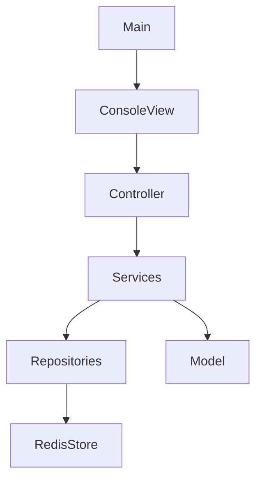

# URL Shortener

Shortener - консольное приложение на Java. В качестве хранилища ссылок используется Redis.

## Установка и запуск

####  Check-up окружения: 


1. Получите исходный код и перейдите в директорию проекта.

   ```bash
   git clone https://github.com/FawkesguyD/shortener.git
   cd shortener
   ```

2. Укажите учётные данные Redis в файле `.env` в директории проекта. Замените приведённые значения на собственные.

   ```dotenv
   REDIS_PASSWORD=example-server-password
   REDIS_USER=shortener
   REDIS_USER_PASSWORD=example-user-password
   ```
3. Запустите сервис Redis.

   ```bash
   docker compose up -d redis
   ```

4. Проверьте состояние сервиса Redis. Перед продолжением убедитесь, что сервис имеет статус `healthy`.

   ```bash
   docker compose ps redis
   ```

5. Запустите приложение. Убедитесь, что меню `URL SHORTENER` открывается без ошибок подключения к Redis.

   ```bash
   mvn compile exec:java
   ```

Если вы используете Task, команда `task redis-up` запускает Redis, а команда `task run` запускает приложение.

Чтобы остановить Redis, выполните:

```bash
docker compose down
```

## Работа с консолью

### User cases

#### Создание ссылки

1. Введите `2` (`Создать ссылку`).
2. В поле `Исходный URL` введите `https://example.com/`.
3. В поле `Лимит переходов` введите `1`.

Результат: в меню вы увидите созданную ссылку

#### Проверка лимита переходов

1. Введите `6` (`Открыть короткую ссылку в браузере`).
2. В поле `Ключ или короткий URL` введите короткий ключ созданной ссылки.
3. Вернитесь в приложение.
4. Повторно введите `6`.
5. Введите тот же короткий ключ.

Результат: В первый раз приложение откроет страницу браузера, во второй раз выведет сообщение о потраченном лимите.

### Дополнительные команды меню

| Команда | Действие | Ввод после команды |
| --- | --- | --- |
| `5` | Просмотр информации о ссылке. | Введите короткий ключ одной из своих ссылок. Нажмите Enter, когда приложение предложит вернуться в меню. |
| `4` | Изменение исходного URL. | Введите короткий ключ. В поле `Новый исходный URL` введите `https://example.org/`. Операция не сбрасывает счётчик переходов и срок действия ссылки. |
| `3` | Удаление ссылки. | Введите короткий ключ. В поле `Удалить ссылку? [да/нет]` введите `да` для подтверждения. |
| `0` | Завершение работы приложения. | Дополнительный ввод не требуется. |

## Конфигурация

При первом запуске приложение создаёт файл `~/.shortener/config.json`, если он отсутствует.

Значения параметров по умолчанию:

```json
{
  "lifetimeHours": 24,
  "defaultMaxClicks": 10,
  "keyLength": 6,
  "baseUrl": "https://clk.ru/",
  "redisUrl": "redis://127.0.0.1:6380"
}
```

| Параметр | Назначение |
| --- | --- |
| `lifetimeHours` | Определяет срок действия новой ссылки. |
| `defaultMaxClicks` | Определяет лимит переходов по новой ссылке. |
| `keyLength` | Определяет количество символов в новом коротком ключе. |
| `baseUrl` | Определяет базовый адрес короткого URL. |
| `redisUrl` | Определяет URL подключения к Redis. |

>Чтобы применить изменения, отредактируйте файл `~/.shortener/config.json` и перезапустите приложение.

### Архитектурные решения

- **UUID пользователя** Приложение хранит идентификатор локального пользователя в файле `~/.shortener/user.id`. В системе могут быть сразу несколько пользователей со своими локальными файлами.
- **Интерфейсы репозиториев.** Сервисы взаимодействуют с интерфейсами репозиториев вместо прямого использования библиотеки Jedis. Это позволяет выполнять модульное тестирование без Redis.
- **Срок действия ссылок.** Redis хранит каждую ссылку в структуре Hash и автоматически удаляет её по истечении срока действия. Это позволяет асинхронно удалять старые ссылки не зависимо от запущенного приложения.
- **Уникальность коротких ключей.** Redis отклоняет создание ссылки, если её короткий ключ уже существует. В этом случае сервис генерирует другой короткий ключ и повторяет операцию. Позволяет избежать ситуаций дублирование ключей.
- **Права владельца.** Только владелец ссылки может просматривать подробную информацию о ней, изменять исходный URL и удалять ссылку.
- **redis как база данных** Выбрана из-за схожести структуры хранения - ключ-значение, также есть встроенный механизм TTL? которые позволяет асинхронно удалять старые ссылки.



| Компонент | Назначение |
| --- | --- |
| `Main` | Загружает конфигурацию, устанавливает соединение с Redis и запускает консольный интерфейс. |
| `ConsoleView` | Отображает меню и передает пользовательский ввод. |
| `Controller` | Передаёт идентификатор пользователя и вызыывает запрашиваемые сервисы. |
| `Services` | Реализуют бизнес логику работы консольного-приложения. |
| `Model` | Определяют ключевые структуры, такие как `Config` и `Link`. |
| `RedisStorage` | Реализует интерфейсы `LinkRepository` и `UserRepository` с использованием библиотеки Jedis. |

## Тестирование

Модульные тесты проверяют работу бизнес-логики, а интеграционные проверяют работу с Redis. Покрытие составляет **> 51 %**. Отчёт будет доступен в `target/site/jacoco/index.html` после `mvn verify`.

```bash
mvn test                   # Только модульные тесты, без Docker
mvn verify -Pintegration   # Все тесты и отчёт о покрытии; нужен запущенный Docker
```

Библиотеки: **JUnit 5**, **Mockito** для зависимостей и **Testcontainers** для redis в контейнере.
